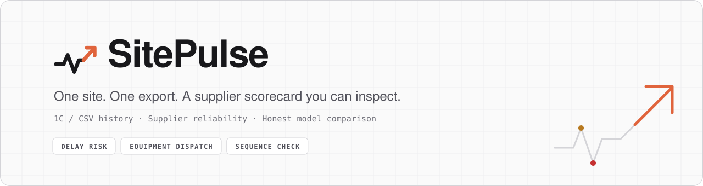
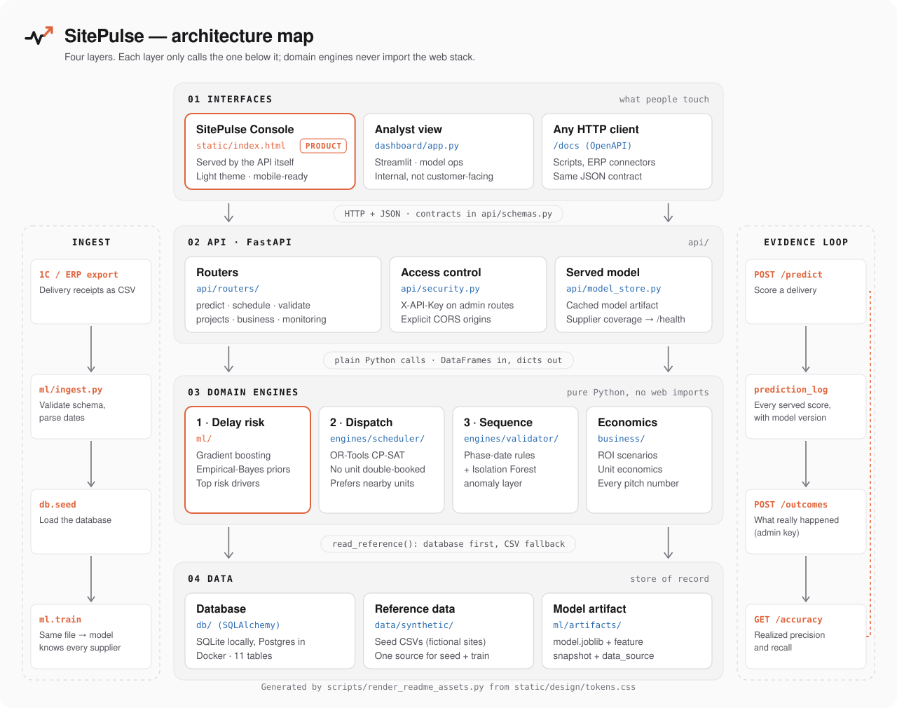
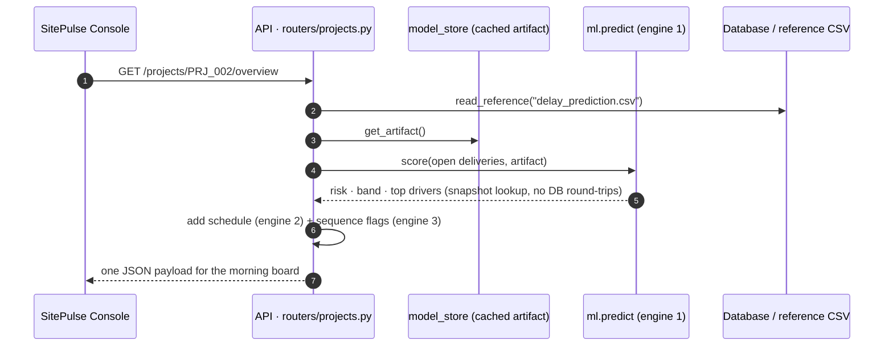

<div align="center">

<picture>
  <source media="(prefers-color-scheme: dark)" srcset="docs/assets/banner-dark.svg">
  
</picture>

<br/>

[](https://github.com/shokkanuly/delivery-delay/actions/workflows/ci.yml)


**[Overview](#overview) · [Architecture](#architecture) · [The four layers](#the-four-layers) · [How a delivery is scored](#how-a-delivery-is-scored) · [Quickstart](#quickstart) · [Validation](#validation-status) · [Docs](#documentation)**

</div>

> [!NOTE]
> **Status:** working software on **synthetic data**. There are no paying customers and no signed pilot yet; the target first pilot partner is BI Group (not yet signed). Every number below says what backs it. See [Validation status](#validation-status).

## Overview

**SitePulse** is decision support for construction holdings that run several large sites at once. Every morning it answers three questions a site logistics manager otherwise answers by phone, WhatsApp and memory:

| The question | Engine | How it answers |
|---|---|---|
| *Which of today's deliveries will arrive late, and why?* | **1 · Delay risk** | A gradient-boosted classifier scores every open order from supplier history, material, route, season and lead time, and lists the top drivers. |
| *Which crane, pump or hoist serves which booking?* | **2 · Equipment dispatch** | A constraint solver (OR-Tools CP-SAT) assigns each booking to a free unit across sites, never double-books a unit, and prefers nearby units for at-risk deliveries. |
| *Is anything arriving before its build phase is ready?* | **3 · Sequence check** | Deterministic phase-date rules flag premature deliveries; an Isolation Forest flags unusual volumes and timings separately. |

All three feed one morning dispatch board: the **SitePulse Console**.

## Architecture

<picture>
  <source media="(prefers-color-scheme: dark)" srcset="docs/assets/architecture-dark.svg">
  
</picture>

Three rules hold the structure together. Tests enforce each one:

1. **Calls only go down.** Interfaces call the API; the API calls engines; engines read data. Engines import no web code, so each can be tested and reused on its own.
2. **One store of record.** Everything persistent lives in the SQL database. Reference CSVs are seed input only, and nothing writes to tracked files at runtime.
3. **One training source.** `db.seed` and `ml.train` read the same file, so the served model knows every supplier it scores; `/health` reports `supplier_coverage`.

## The four layers

### 01 · Interfaces: what people touch

| Surface | Path | For |
|---|---|---|
| **SitePulse Console** (the product) | [`static/index.html`](static/index.html) | Site and procurement teams. Served by the API at `/`, so there is one process and one URL. Mobile-ready. |
| Analyst view (internal) | [`dashboard/app.py`](dashboard/app.py) | Model operations and exploration in Streamlit. Not a customer surface. |
| Any HTTP client | `/docs` (OpenAPI) | ERP connectors and scripts, using the same JSON contract. |

Both UIs share one design system, [`DESIGN.md`](DESIGN.md), with its tokens in [`static/design/`](static/design). Every number on screen carries a badge saying what backs it: *Correctness Invariant*, *Estimate*, *Synthetic Data*, *Sanity Check* or *Operating Input*.

### 02 · API: FastAPI, one service

[`api/main.py`](api/main.py) only wires things together; each domain has its own router.

| Router | Endpoints |
|---|---|
| [`predict`](api/routers/predict.py) | `POST /predict` · `POST /predict/batch` · `GET /deliveries/{project_id}` · `GET /health` · `GET /metrics` · `POST /train`* |
| [`schedule`](api/routers/schedule.py) | `POST /schedule` · `POST /schedule/upload` · `GET /schedule/demo` |
| [`validate`](api/routers/validate.py) | `POST /validate` · `POST /validate/upload` · `GET /validate/demo` |
| [`projects`](api/routers/projects.py) | `GET /projects` · `GET /projects/{id}/overview` (all three engines for one site) |
| [`business`](api/routers/business.py) | `GET /economics` · `POST /economics/site` · `POST /projects/workspace` · `GET /projects/workspace/{key}` |
| [`monitoring`](api/routers/monitoring.py) | `POST /outcomes`* · `GET /accuracy` · `GET /predictions` |

\* Admin routes need an `X-API-Key` header that matches `SITEPULSE_ADMIN_KEY` ([`api/security.py`](api/security.py)). With no key configured they are closed. Workspace keys are issued by the server, and demo workspaces are read-only. Request and response shapes live in [`api/schemas.py`](api/schemas.py); the served model is cached in [`api/model_store.py`](api/model_store.py).

### 03 · Domain engines: pure Python

| Engine | Package | In → out | Guarantee and limit |
|---|---|---|---|
| **1 · Delay risk** | [`ml/`](ml) | order fields → late probability, risk band, top drivers | Features are causal (a test fails on future leakage). New suppliers fall back to material×route priors. The model is scikit-learn `HistGradientBoostingClassifier`, with LightGBM as an optional one-line swap. |
| **2 · Equipment dispatch** | [`engines/scheduler/`](engines/scheduler) | fixed-time bookings + fleet → assignment per booking | No unit is ever double-booked (`AddNoOverlap`, tested). When demand exceeds the fleet it drops the lowest-priority bookings and reports them. It does not yet re-time bookings on a single tower crane. |
| **3 · Sequence check** | [`engines/validator/`](engines/validator) | deliveries + phase schedule → flags with reasons | Flags every delivery dated before its phase. It is only as good as the phase schedule it is given. |
| **Economics** | [`business/`](business) | source-tagged assumptions → ROI scenarios, unit economics, forecast | The single source of every pitch number; [`tests/test_pitch_claims.py`](tests/test_pitch_claims.py) fails if a doc quotes anything else. |

### 04 · Data: the store of record

- **Database** ([`db/`](db)): SQLAlchemy over SQLite locally, or Postgres in Docker and Render. It has 11 tables: `suppliers`, `projects`, `deliveries`, `resources`, `booking_requests`, `build_phases`, `phase_material_map`, `material_deliveries`, `prediction_log`, `weather_log` and `workspaces`.
- **Reference data** ([`data/synthetic/`](data/synthetic)): seed CSVs for five fictional sites. Engines read data through `read_reference()`, which tries the database first and falls back to the CSV.
- **Model artifact** (`ml/artifacts/model.joblib`): the model, a frozen feature snapshot (so scoring is stateless), its metrics and its `data_source`.

**Cross-cutting flows** (the side lanes of the map):
- **Ingest:** 1C / ERP CSV → [`ml/ingest.py`](ml/ingest.py) (schema and date validation) → `db.seed` and `ml.train`, both from the same file.
- **Evidence loop:** every served score goes to `prediction_log` with its model version → `POST /outcomes` records what really happened → `GET /accuracy` reports realized precision and recall.

## How a delivery is scored



## Quickstart

Requirements: Python 3.11+ on macOS or Linux.

```bash
./start.sh            # seeds, trains, generates an admin key, starts API + analyst view
```

| Open | URL |
|---|---|
| **SitePulse Console**, the product (demo this) | http://localhost:8000 |
| API reference (OpenAPI) | http://localhost:8000/docs |
| Every pitch number and its assumptions | http://localhost:8000/economics |
| Model health and supplier coverage | http://localhost:8000/health |
| Analyst view (Streamlit, internal) | http://localhost:8501 |

<details>
<summary><b>Manual steps · Docker · tests</b></summary>

```bash
python3 -m pip install -r requirements.txt
python3 -m db.seed                      # loads data/synthetic/delay_prediction.csv
python3 -m ml.train                     # trains on the same file
export SITEPULSE_ADMIN_KEY=$(python3 -c "import secrets; print(secrets.token_urlsafe(24))")
python3 -m uvicorn api.main:app --port 8000
```

```bash
cp .env.example .env                    # set SITEPULSE_ADMIN_KEY
docker compose up --build               # Postgres + seed/train + API + analyst view
```

```bash
pytest                                  # full suite: leakage guard, solver invariant, contracts, claims, design rules
python3 -m scripts.evidence_loop        # train on oldest 80%, score newest 20%
python3 -m scripts.render_readme_assets # regenerate the banner and architecture map
```
</details>

## Validation status

> [!IMPORTANT]
> All metrics come from a **synthetic benchmark**: 2,200 deliveries and 260 equipment bookings. **No live field data is connected yet.** The generator encodes supplier reliability, season, route and lead time as the delay drivers, so these numbers show the pipeline works end to end without leakage. They do **not** show that real deliveries are this predictable; the pilot measures that on the customer's own 1C history.

**Delay model vs. baselines** (5-fold CV, n = 2,200, late base rate 40.9%; reproduce with `python3 -m ml.train`):

| Metric | Random | Supplier-average baseline | SitePulse model | Lift (95% CI) |
|---|:---:|:---:|:---:|:---:|
| PR-AUC | 0.409 | 0.619 | **0.669** | +0.050 [0.018, 0.082] |
| ROC-AUC | 0.500 | 0.689 | **0.728** | +0.039 [0.025, 0.053] |
| F1 @ 0.5 | — | 0.533 | **0.551** | +0.017 [−0.006, 0.040] *(not significant)* |

**Time-ordered holdout** (train on the oldest 80%, score the newest 440 deliveries; `python3 -m scripts.evidence_loop`):

| Risk band | Deliveries | Actually late |
|---|:---:|:---:|
| Green | 287 | 24.4% |
| Yellow | 51 | 43.1% |
| Red | 102 | **74.5%** |

Red deliveries ran late about 3× as often as green ones. The bands rank risk usefully even though the overall lift is modest.

**Known limits.** Recall at the 0.5 cutoff is 0.45, so set the threshold from the real cost of a missed delay. The expected-delay-days estimate does not beat predicting the mean (MAE 4.20 vs 4.19 days), so only the risk score is used for decisions.

| Claim | Kind | What it means |
|---|---|---|
| No equipment unit double-booked | **Correctness invariant** | A tested property of the solver, like a calendar lock; not a measure of business impact. |
| Every delivery dated before its phase is flagged | **Correctness invariant** | True by definition of the rule; useful only if the schedule is current. |
| Delay-model lift above | **Statistical estimate** | Synthetic benchmark; re-measured on real data in pilot weeks 3–4. |
| Losses avoided per site-year | **Assumption-based** | Founder assumptions in [`business/economics.py`](business/economics.py), not yet measured on a site. |

## Business model

- **Pilot:** $15k flat for 8 weeks on 2 sites, credited against the first annual contract.
- **Subscription:** $3,500 – $4,800 / site / month.
- **Estimated losses avoided** on demo Site B, per site-year: **$103k** in the base case (2.5× the licence). The conservative case is $46k (1.1×), so the licence is still covered. These are assumptions until the pilot measures them.

Every figure comes from [`business/economics.py`](business/economics.py) (`GET /economics`). Pilot plan and data requirements: [`docs/PILOT_PROPOSAL.md`](docs/PILOT_PROPOSAL.md).

<details>
<summary><b>Demo data</b> (fictional sites and read-only demo keys)</summary>

| Site | Project | City | Demo workspace key |
|---|---|---|---|
| Site A | `PRJ_001` · Urban residential | Almaty | `DEMO-SITE-A-2026` |
| Site B | `PRJ_002` · Commercial & residential high-rise | Astana | `DEMO-SITE-B-2026` |
| Site C | `PRJ_003` · Embankment towers | Astana | `DEMO-PILOT-KEY` |
| Site D | `PRJ_004` · Industrial logistics park | Karaganda | — |
| Site E | `PRJ_005` · Regional trade center | Shymkent | — |

Demo keys are read-only. Save a workspace with a blank key and the server issues your own.
</details>

## Repository structure

```
api/              FastAPI service: main.py (wiring), routers/, schemas.py, security.py, model_store.py
ml/               Engine 1: labeling, causal features, training, prediction, ingest
engines/          Engine 2 (scheduler/, CP-SAT) and Engine 3 (validator/, rules + Isolation Forest)
business/         Economics: pricing, ROI scenarios, unit economics, forecast
db/               SQLAlchemy models (11 tables), session, seed
data/synthetic/   Seed CSVs and demo workspaces (fictional sites)
static/           SitePulse Console (index.html) and design/ tokens, logo and mark
dashboard/        Internal Streamlit analyst view
scripts/          evidence_loop.py, render_readme_assets.py
tests/            pytest suite, run in CI on Python 3.11 and 3.12
docs/             Architecture, PRD, pilot proposal, pitch deck, runbook, ADRs, plans, README assets
```

## Documentation

| Doc | What's in it |
|---|---|
| [`docs/ARCHITECTURE.md`](docs/ARCHITECTURE.md) | Data flows and the reasoning behind the key design choices |
| [`docs/adr/`](docs/adr) | Architecture decision records: stateless feature snapshot, CP-SAT, hybrid validation |
| [`DESIGN.md`](DESIGN.md) | Design system: tokens, the claim-badge vocabulary, layout and motion rules |
| [`docs/PILOT_PROPOSAL.md`](docs/PILOT_PROPOSAL.md) | The 8-week pilot, data requirements, pricing |
| [`docs/INVESTOR_DECK.md`](docs/INVESTOR_DECK.md) | Pitch script and Q&A preparation |
| [`docs/RUNBOOK.md`](docs/RUNBOOK.md) | Operating and deployment procedures |
| [`docs/plans/`](docs/plans) | Credibility fixes and architecture review: findings and outcomes |
| [`CHANGELOG.md`](CHANGELOG.md) | Build history |

## License

[MIT](LICENSE) © 2026 shokkanuly
