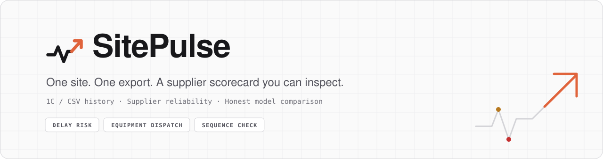

<div align="center">
<picture>
  <source media="(prefers-color-scheme: dark)" srcset="docs/assets/banner-dark.svg">
  
</picture>

[](https://github.com/shokkanuly/delivery-delay/actions/workflows/ci.yml)

[](LICENSE)

**[Try the demo](https://logistics-api-production-2e47.up.railway.app/#audit) · [3-minute judge guide](docs/JUDGES.md) · [Research → decisions](docs/RESEARCH.md)**
</div>

## Proposed next product: delivery evidence at the site

The **2 November 2026 product plan** centres on one construction site's receiving workflow:
planned delivery → arrival and quantity evidence → named receiver confirmation or dispute →
traceable receipt packet. Historical audits remain useful; document reconciliation, bank data
sharing and energy measurement follow validation gates.

**This is the next product plan, not functionality shipped in this revision.** The current
prototype and synthetic demo are described below. Start with the [new product scope](docs/PRD.md),
[90-day roadmap](ROADMAP.md), [implementation backlog](docs/plans/delivery-evidence-reshape.md)
and [30-day pilot protocol](docs/PILOT_PROPOSAL.md). The supplied
[research packet](docs/research/README.md) is retained with its verification limits.

## One export. One site. A supplier scorecard you can inspect.

SitePulse helps a construction contractor review delivery reliability from a 1C/CSV history:
which suppliers arrive on time, how uncertain that estimate is, and whether a risk model adds
anything beyond the supplier's own average. It complements the accounting system.

**Working prototype, synthetic demonstration data. No paying customers, signed pilot or real
customer audit is recorded in this repository.** Those are the next validation steps, not traction
we claim today.

## Try it in three minutes

1. Open the [product console](https://logistics-api-production-2e47.up.railway.app/#audit) and choose
   **«Открыть пример отчёта»**. The example needs no account or admin key.
2. Inspect the quality report and supplier/material scorecards. Download the same synthetic CSV
   and compare it with the report: **12 rows → 8 accepted, 4 excluded, 5 suppliers**.
3. Read the backtest verdict. This tiny example deliberately reports insufficient history;
   it does not invent model accuracy. Open the calculator's example to see **350,000 ₸** of
   illustrative contract exposure, not measured savings.

The sample is a saved calculation from the downloadable fixture, generated by
[`scripts/build_demo_report.py`](scripts/build_demo_report.py). Personal/customer uploads still
require an operator's admin key. Never publish that key. Railway hosts synthetic data only;
real customer data requires the Kazakhstan/on-prem deployment described in the plan.

[API reference](https://logistics-api-production-2e47.up.railway.app/docs) ·
[Live health](https://logistics-api-production-2e47.up.railway.app/health) ·
[Internal analyst view](https://logistics-dashboard-production-a609.up.railway.app/)

## What works, and what is next

| Capability | Evidence / boundary |
|---|---|
| 1C CSV import: Russian headers, UTF-8/Windows-1251, mixed dates | Quality report counts dropped rows, duplicates and defaults; CSV only, 5 MB / 10,000 rows. |
| Supplier and supplier × material scorecards | Delivery counts, on-time share, Wilson 95% interval, late-day median/p90 and a shared 90-day trend. |
| Historical model comparison | Chronological 70/30 split; date ties stay together; unresolved training outcomes are purged. Risk bands appear only if the model beats the supplier-average baseline. |
| Exposure in tenge | Required contract/rental inputs; no assumed customer rates. Exposure is not proven savings. |
| Equipment scheduling and phase checks | CP-SAT no-overlap invariant and deterministic phase-date rules, covered by tests. Fixed-time assignment is implemented; human booking approval is planned. |
| Arrival evidence loop | Signed, idempotent gate-event intake, review queue, prediction/outcome logs and accuracy endpoints. No connected live gate is claimed. |
| Next receiving workflow | Migrations, named site access, richer receipt evidence, offline capture and customer hosting remain [planned](ROADMAP.md). Booking approval and outbound notifications follow demonstrated need. |

## Evidence, without inflated claims

On the bundled **2,200-delivery synthetic benchmark**, the model's five-fold CV PR-AUC is **0.669**
versus **0.619** for the supplier-average baseline. That is a modest pipeline result, not field
accuracy. The generator encodes its delay drivers. A contractor's history must be evaluated
separately, and the scorecard remains useful if the model fails to beat the baseline.

The no-double-booking check proves a software constraint; it does not prove reduced crane idle
time. No measured savings, market share or customer willingness to pay is claimed.

```bash
python -m pytest                         # invariants, contracts, leakage and claim guards
python -m scripts.build_demo_report --check  # public sample matches its exact CSV bytes
python -m ml.train                       # reproduce the synthetic CV benchmark
python run.py                            # ML correctness demonstration
```

See the [judge guide](docs/JUDGES.md) for expected results, failure cases and technical Q&A.

## Run locally

Use Python **3.11 or 3.12**:

```bash
git clone https://github.com/shokkanuly/delivery-delay.git
cd delivery-delay
python3 -m venv .venv
source .venv/bin/activate
pip install -r requirements.txt
./start.sh
```

Open **http://localhost:8000/** for the product, `/docs` for the API and port `8501` for the
internal analyst view. The synthetic sample works without sharing an operator key. For your
own local upload, set `SITEPULSE_ADMIN_KEY` in the shell before starting. The script otherwise
generates an ephemeral key for its processes.

Docker alternative: copy `.env.example` to `.env`, set your own admin key, then run
`docker compose up --build`. Keep `.env`, databases and trained artifacts out of Git.

## Product and commercial hypothesis

First candidate: a contractor with one accessible pilot site and an accountable receiving team.
The earlier Karaganda/1C-history entry route remains an option; select the site by actual access
and need. Offer a historical audit when useful, then agree a one-site, 30-day receiving pilot
after field readiness. The founder's **150,000–300,000 ₸ per active site/month** subscription range
is a hypothesis to test, not a validated price or a binding offer. Suppliers are not the payer.

Voyage Control is an established delivery/equipment-booking alternative; spreadsheets, phone
coordination and existing ERP workflows are substitutes to investigate in interviews. We claim
no unique feature monopoly or proven market size. See [research and open questions](docs/RESEARCH.md)
and the [one-site pilot proposal](docs/PILOT_PROPOSAL.md).

## Repository map

| Path | Responsibility |
|---|---|
| `api/` | FastAPI routers, typed contracts, admin/workspace access and signed ingest |
| `ml/` | Import, shared lateness labels, scorecards, causal features and frozen-model scoring |
| `engines/` | Equipment scheduling and phase/sequence validation |
| `business/` | Tenge exposure; legacy assumption-based scenarios remain separate |
| `db/` | SQLAlchemy models, sessions and synthetic seeding |
| `static/` | Product console, design tokens and public synthetic examples |
| `dashboard/` | Internal Streamlit analyst view |
| `scripts/`, `tests/` | Reproduction tools and automated verification |

Domain packages import no web frameworks. Scoring uses the artifact's frozen feature snapshot,
not live database queries. Each pilot gets its own deployment. See [architecture](docs/ARCHITECTURE.md),
[ADRs](docs/adr/), [contributing](CONTRIBUTING.md) and [runbook](docs/RUNBOOK.md).

[Current roadmap](ROADMAP.md) · [3-minute pitch](docs/INVESTOR_DECK.md) ·
[Interview evidence register](docs/CUSTDEV_LOG.md) · [Changelog](CHANGELOG.md) · [MIT license](LICENSE)
