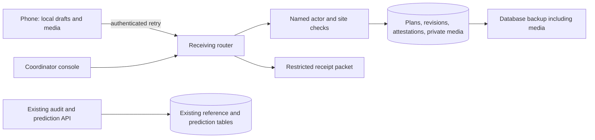

# ADR 0004: receiving evidence independent of predictions

2 November 2026 · Accepted for local implementation; field acceptance remains open.

## Context and invariants

Receiving must work without a trained model. Existing project/reference APIs serve a public
synthetic demonstration, so customer receiving records must not enter those tables or public
responses. Named, revocable site access and revision-specific confirmation are required.

## Council review

- **Consistency/topology:** one relational transaction per evidence mutation; a receipt row
  serializes revisions/attestations. Immutable revisions and unique operation IDs make retries
  recoverable. Model outcomes are not the receiving source of truth.
- **Security:** separate receiving tables; site scope checked for plans, receipts, media and
  exports. Store hashes of revocable per-person credentials. Browser credentials stay in memory;
  offline drafts contain no admin or machine signing secret. No external analytics or CDN assets.
- **Reliability:** IndexedDB keeps drafts and media through reload; UI distinguishes local,
  uploaded and confirmed. Failed/expired sessions leave drafts recoverable. Versioned schema
  upgrades and database backups include evidence media.
- **Performance/data:** bounded lists and uploads; decimal strings preserve quantities in
  revision JSON. Serializing one receipt avoids unrelated site contention on Postgres; SQLite
  has a broader writer limit and is for local/rehearsal use.
- **Cost/velocity:** keep FastAPI, SQLAlchemy and static JS. Store bounded media in the database
  for the initial low-volume pilot: atomic permissions, no orphaned object-store uploads, and
  one recoverable backup. Revisit object storage when measured volume makes DB backups unwieldy.

## Trade-offs

| Dimension | Selected | Alternative | Cost / consequence |
|---|---|---|---|
| Customer identity | Separate receiving site/actor records | Reuse public demo project rows | Some duplicated site metadata; explicit boundary prevents legacy public API leaks. |
| Authentication | Per-person random bearer credential, hashed in DB, revocable | Password/OIDC service | Operator provisions credentials; no self-service recovery. HTTPS and careful device use required. |
| Evidence | Immutable revision snapshots with serialised mutation | Overwrite arrival row | More rows, but historical confirmations remain attributable. |
| Media | Size-bounded database blobs | External object storage | Larger backups; transactional consistency and simple restore initially. |
| Offline | Local IndexedDB drafts and app-shell service worker | Native mobile app | Requires first online visit; browser storage can be evicted and devices need field testing. |
| Integrity | Digests and application audit | External timestamp/third-party witness | Detects mismatches; does not prove physical arrival or prevent a privileged DB operator rewriting history. |

## Decision and consequences

Implement a separate `/receiving` API and console with shared visual tokens. Preserve legacy
contracts. Add migrations before new tables. A real/synthetic provenance flag is mandatory;
public demo records never become pilot metrics. Read-only partner access, reconciliation and
notifications are separate, explicitly controlled extensions. No finance execution is added.

**Verdict: APPROVED WITH CONDITIONS.** Before field use: verify concurrency/site isolation,
offline recovery on actual phones, backup/restore on the chosen Postgres deployment, and the
host's access/retention policy. These are engineering release conditions, not customer evidence.

Immediate steps: migration baseline; scoped actor/plan APIs; receipt/revision/attestation and
media tests; phone flow and offline tests; isolated deployment/restore rehearsal.

Migration references: [Alembic tutorial](https://alembic.sqlalchemy.org/en/latest/tutorial.html).
