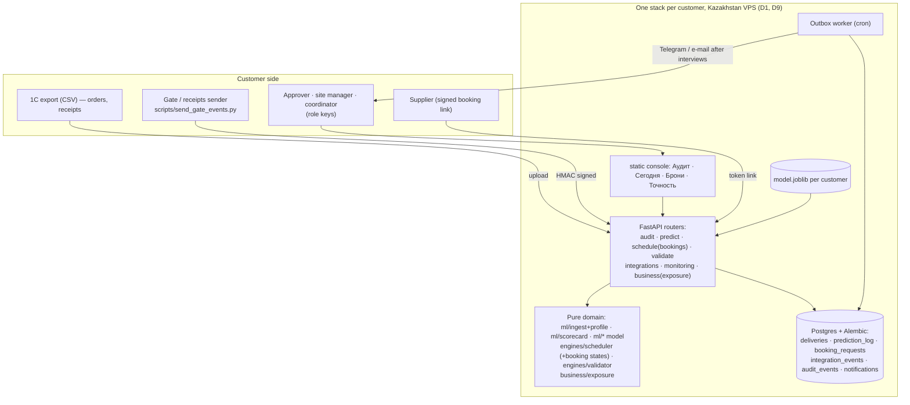

# SitePulse — MVP reshape: architecture, system design and build roadmap (2026-10-19)

Status: `[ ]` todo · `[~]` in progress · `[x]` done. Work **one stage per Claude Code session**, in order.
Mark the stage `[~]` when you start, `[x]` when its *Done when* passes, and write mid-build notes in §7.

Source of the product decisions: the market research and MVP plan of 19 Oct 2026 (Idea Miners). The short version:
stop selling "prediction + optimisation across a holding"; sell **a closed delivery-risk loop for one site** whose first
paid output is a **supplier on-time scorecard** built from the customer's own 1C history.

---

## 1. Why (problem, users, constraints, success)

- **Problem.** A contractor's 1C knows what was ordered and received, but not which delivery will miss its crane or
  unloading slot. The team needs (a) a credible audit of the customer's history in days, (b) a one-site pilot with live
  data in 30 days, (c) a paid site in 90 days.
- **Users.** Head of supply / project director (buyer, approves slots), site manager and crane/gate coordinator
  (daily users), suppliers (book slots for free, never pay or log in with a password), the founder (operator during pilots).
- **Constraints.** Two-person student team. Keep the stack: FastAPI, SQLAlchemy, scikit-learn, OR-Tools, the static
  HTML console (`static/index.html`, the product UI) and Streamlit (internal analyst view only). 155 tests stay green.
  Customer data must be hosted in Kazakhstan or on the customer's server. No new framework without the founder's OK.
- **Success.**
  - Day 9 (final, 28 Oct): any real 1C export → audit report (scorecard + backtest) in under 10 minutes.
  - Day 30: one pilot site where ≥ 80% of deliveries get an actual arrival through ingest, and staff open the at-risk
    list ≥ 3 days a week.
  - Day 90: the pilot is paid, and live accuracy is reported only after ≥ 100 resolved deliveries.

## 2. The territory (what exists — keep these conventions)

- **Layering is enforced by a test.** Domain packages `ml/`, `engines/`, `business/` are framework-free and must not
  import `fastapi`, `starlette`, `streamlit`, `requests`, `api` or `dashboard` (`tests/test_layering.py`). They take
  DataFrames or dicts and return data.
- **API = one router per domain** in `api/routers/<domain>.py`, wired in `api/main.py` (wiring only). Schemas in
  `api/schemas.py`. Reference data is read DB-first with CSV fallback (`api/data_sources.read_reference`).
- **One schema of record:** SQLAlchemy models in `db/models.py`; SQLite locally, Postgres via `DATABASE_URL`.
  Tables are created by `db.database.init_db()` (`create_all`) — **there are no migrations yet** (see D5).
- **The model is a frozen artifact** (`ml/artifacts/model.joblib`) carrying its feature snapshot, data source and
  metrics; the API never touches training internals (ADR 0001). Retrain = `python -m ml.train <csv>`.
- **Access control today:** admin key (`X-API-Key` = `SITEPULSE_ADMIN_KEY`) on mutating endpoints, server-issued
  workspace keys, and HMAC-signed machine ingest (`api/signing.py`, `SITEPULSE_INGEST_KEYS`).
- **Evidence loop:** `/predict` logs every served prediction (`PredictionLog`); `/outcomes` (manual) and
  `POST /integrations/gate-events` (signed, idempotent per `event_id`) fill actual arrivals; `/accuracy` scores them;
  unmatched arrivals wait in `/integrations/review`; every change writes `AuditEvent`.
- **Tests** run on a temp SQLite DB and a small temp-trained model (`tests/conftest.py`), and pin invariants, not
  exact numbers. `tests/test_pitch_claims.py` keeps README/deck numbers honest.
- **Deploy today:** `docker-compose.yml` (Postgres + seed/train + API + dashboard) and `render.yaml` (Render, US/EU —
  fine for a synthetic demo, **not** for customer data).

**Gaps against the new scope**

| Gap | Where it bites |
|---|---|
| No mapping from real 1C exports (Russian headers, cp1251, `;`) to the canonical delivery columns | The audit cannot run on a customer file |
| No supplier scorecard | The first thing we sell does not exist |
| No time-split backtest on a customer's history from the API | "Does it work on our data?" has no answer |
| `BookingRequest` has no request → approve/reject/move states or requester/approver | The Voyage-Control-style flow is missing |
| Roles: only "admin" or "anyone" | Site manager vs approver vs supplier cannot be told apart |
| No outbound notifications | The daily at-risk list cannot reach the site |
| `business/economics.py` runs on founder assumptions | Value must be computed from the customer's own rates |
| No migrations | Pilot data cannot survive a schema change |
| Render hosting | Customer data must stay in Kazakhstan |

## 3. Design decisions (options → choice → why)

**D1. Tenancy.**
- A. **One deployment per pilot customer** (own compose stack, own Postgres, own model artifact).
- B. `tenant_id` on every table and every query, one shared deployment.
- C. Postgres schema per tenant.

**Chosen: A** for the first 90 days. Zero schema churn, isolation by construction, and the "your data stays on a server
in Kazakhstan / on yours" promise is literally true. Cost: ops work per customer and no cross-customer view. Revisit
with B when there are ≥ 3 paying customers (Stage 12).

**D2. Roles.**
- A. **Role-scoped API keys** in env (`SITEPULSE_KEYS="approver:<key>,site:<key>"`) and a `require_role()` dependency
  next to `require_admin`.
- B. User accounts with passwords/JWT (new libraries, password reset, e-mail).
- C. Magic links.

**Chosen: A.** Same pattern as `require_admin`, no new dependency, enough for one site with 3–6 people. Suppliers get a
**per-booking signed link** (token = HMAC of booking id, reusing `api/signing.py`), never an account. Move to B only if a
customer asks for named logins (Stage 11).

**D3. 1C import.** Extend `ml/ingest.py` with a **column profile**: a table of known 1C / Excel header aliases →
canonical columns, encoding sniffing (utf-8-sig, cp1251), delimiter sniffing, date and number parsing, and a
data-quality report (rows dropped and why). Pure function, no new dependency. XLSX needs `openpyxl` — **new dependency,
ask before adding**; until then customers save as CSV.

**D4. Scorecard and audit.** `ml/scorecard.py` (pure): per supplier and per supplier × material — deliveries, on-time
share with a Wilson 95% interval, median and p90 days late, trend of the last 90 days vs before. Lateness uses the
existing per-material grace in `ml/labeling.py` so "late" means the same thing everywhere. The **audit** = scorecard +
a **time-split backtest** (train on the first 70% by `order_date`, score the last 30%: red vs green late rate, PR-AUC
vs the supplier-average baseline from `ml/baseline.py`) + the data-quality report. The model is shown only if it beats
the baseline on that customer's data; otherwise the report says so and the scorecard stands alone.

**D5. Migrations.** Pilot data must survive upgrades, and `create_all` cannot add a column to an existing table.
**Introduce Alembic** (new dependency — confirm with the founder) with a baseline migration of today's models, before
Stage 5 changes `booking_requests`. Tests keep using `create_all` on a temp DB.

**D6. Slot booking flow.** Add `status` (`requested|approved|rejected|moved|cancelled`), `requested_by`, `decided_by`,
`decided_at`, `reason` to `BookingRequest`. Transitions live in a pure function in `engines/scheduler/` (state table,
tested). The OR-Tools solver **proposes**; a person with the approver role **decides**; every transition writes
`AuditEvent`. Double-booking stays impossible: approving re-checks overlap with `verify_no_double_booking`.

**D7. Daily at-risk list.** An **outbox table** (`notifications`: channel, recipient, payload, status, attempts,
next_attempt_at) written in the same transaction as the list, and a CLI worker that sends with retries — the JanaМен
(shokkanuly/posttech) outbox pattern. The channel adapter is chosen after interviews (Telegram bot, e-mail or WhatsApp);
until then the "Сегодня" console view and a printable page are the channel.

**D8. Value in tenge.** New `business/exposure.py` (pure): exposure = value of the delayed supply or phase × the
contract's daily penalty × days late + rented-crane idle hours × the customer's hourly rate. **No defaults**: a missing
input is an error, never an assumption. `business/economics.py` stays for the pitch scenarios and keeps its "founder
assumption" labels.

**D9. Hosting.** Production profile of `docker-compose.yml` on a Kazakhstan VPS (Hoster.kz / PS Cloud class): Postgres
with a named volume, nightly `pg_dump` to a second disk, the API behind a TLS reverse proxy (Caddy — **new component,
confirm**), Streamlit not exposed. `render.yaml` stays for the synthetic public demo only.

## 4. Target architecture

**Boundaries to keep in agreement:** canonical delivery columns (`ml/ingest.CORE_REQUIRED`) ↔ the column profile ↔ the
console upload view; `BookingRequest.status` values ↔ console ↔ state table; the artifact contract (ADR 0001); the HMAC
header set (`X-Key-Id`, `X-Timestamp`, `X-Nonce`, `X-Signature`) ↔ the sender script.

## 5. Roadmap

### Stage 0 — Agent setup `[x]`
- **Goal:** Claude Code sessions start with the right rules and this plan.
- **Steps:** `CLAUDE.md` at the repo root; this file.
- **Done when:** `python -m pytest -q` passes (155).

### Stage 1 — 1C column profile and data-quality report (D3) `[x]`  · *needed by the final, 28 Oct*
- **Goal:** a real-looking 1C export becomes the canonical delivery frame, with a report of what was dropped.
- **Steps:** in `ml/ingest.py` add `COLUMN_PROFILE` (alias table, e.g. «Поставщик», «Контрагент» → `supplier_id`;
  «Номенклатура»/«Материал» → `material_type`; «Дата заказа» → `order_date`; «Плановая дата поставки»/«Срок» →
  `promised_date`; «Дата поступления»/«Дата прихода» → `actual_date`; «Количество» → `quantity`), `sniff_csv(raw)`
  (encoding + delimiter), `load_export(raw, profile) -> (DataFrame, QualityReport)`; route type defaults to `"unknown"`
  and is reported, never invented. Add `tests/fixtures/1c_export_cp1251.csv` (synthetic, Russian headers, `;`, cp1251,
  dd.mm.yyyy dates, spaces in numbers) and `tests/test_ingest_profile.py`.
- **Depends on:** Stage 0.
- **Done when:** the fixture loads to the canonical columns; a file missing a required column fails with the Russian
  names of the missing columns; the quality report counts bad dates and duplicates; all tests pass.

### Stage 2 — Supplier scorecard (D4) `[x]` · *final*
- **Goal:** the first sellable output.
- **Steps:** `ml/scorecard.py` with `supplier_scorecard(df) -> DataFrame` and `material_breakdown(df)`; Wilson interval
  helper; lateness via `ml.labeling` grace. `tests/test_scorecard.py` with a hand-computed known answer (e.g. 7 of 10 on
  time → 0.70, interval checked against a reference value).
- **Depends on:** Stage 1.
- **Done when:** known-answer tests pass; `tests/test_layering.py` still passes.

### Stage 3 — History audit endpoint and console view (D4) `[ ]` · *final*
- **Goal:** upload a 1C export → audit report in the console, printable to PDF from the browser.
- **Steps:** `api/routers/audit.py` with `POST /audit/history` (multipart, size limit, admin or approver key) returning
  quality report + scorecard + time-split backtest (`ml/train` helpers on the uploaded frame, temp artifact, never the
  production one) + "model beats baseline: yes/no"; wire in `api/main.py`; add an «Аудит выгрузки» view to
  `static/index.html` following its existing view pattern (and print CSS). Nothing uploaded is stored unless
  `?save=true` (pilot mode).
- **Depends on:** Stages 1–2.
- **Done when:** `curl -F file=@tests/fixtures/1c_export_cp1251.csv -H "X-API-Key: …" localhost:8000/audit/history`
  returns the three blocks; an API test covers it; the console view renders the fixture and Ctrl+P gives a clean page.

### Stage 4 — Exposure in tenge (D8) `[ ]`
- **Goal:** value expressed with the customer's numbers only.
- **Steps:** `business/exposure.py` (pure) + `POST /economics/exposure` in `api/routers/business.py`; console form on
  the audit view.
- **Depends on:** Stage 3.
- **Done when:** known-answer test (e.g. 50 000 000 ₸ × 0.1% × 4 days + 6 h × 25 000 ₸ = 350 000 ₸); missing input →
  422 naming the field.

### Stage 5 — Migrations (D5) `[ ]` · *confirm Alembic with the founder first*
- **Goal:** schema changes no longer require a fresh database.
- **Steps:** add `alembic` to `requirements.txt`; `alembic init migrations`; baseline revision from `db.models`;
  `start.sh` and the compose `seed` service run `alembic upgrade head` before seeding; tests keep `create_all`.
- **Depends on:** nothing (do before Stage 6).
- **Done when:** a fresh Postgres in compose reaches `head`; `alembic check` reports no drift; tests pass.

### Stage 6 — Roles and slot request → approve flow (D2, D6) `[ ]` · *30-day MVP*
- **Goal:** a site manager requests a crane/gate slot, the approver approves, moves or rejects it, every change logged.
- **Steps:** `require_role()` in `api/security.py` + `SITEPULSE_KEYS`; migration adding the booking columns;
  `engines/scheduler/states.py` (pure transition table + tests); routes in `api/routers/schedule.py`:
  `POST /schedule/bookings`, `POST /schedule/bookings/{id}/decision`, `GET /schedule/bookings?day=`; approval re-runs
  the overlap check; supplier link `GET /schedule/bookings/{id}/supplier?token=` (read + confirm only); console «Брони».
- **Depends on:** Stage 5.
- **Done when:** tests prove: illegal transitions → 409; approving an overlapping slot → 409; a wrong role → 403; a
  forged supplier token → 401; every transition creates an `AuditEvent`.

### Stage 7 — Daily at-risk list and outbox (D7) `[ ]` · *30-day MVP*
- **Goal:** each morning the site sees the open deliveries ranked by risk, with reasons.
- **Steps:** `GET /today` (open deliveries for the next N days, scored, with drivers and the supplier's scorecard line);
  console «Сегодня»; `Notification` model + migration; `scripts/outbox_worker.py` with retries/backoff; one channel
  adapter **after the interviews decide the channel**.
- **Depends on:** Stages 2, 5.
- **Done when:** `/today` test on seeded data; the worker sends to a fake adapter, retries a failure, never sends twice
  (idempotency key = date + recipient).

### Stage 8 — Kazakhstan deployment (D9) `[ ]` · *before any real customer data*
- **Goal:** one customer stack on a Kazakh VPS, backed up, with no demo data.
- **Steps:** `docker-compose.prod.yml` (no seed of synthetic data, no Streamlit port, Caddy TLS), `.env.prod.example`,
  nightly `pg_dump` cron + restore test, `docs/RUNBOOK.md` section «Новый клиент» (create stack, keys, sender script).
- **Depends on:** Stage 5.
- **Done when:** on a clean VM, the runbook brings up a stack; `/health` is green over HTTPS; a backup restores into a
  second database and `/accuracy` returns the same numbers.

### Stage 9 — Pilot kit `[ ]` · *30-day MVP*
- **Goal:** everything needed to start a pilot in one meeting.
- **Steps:** `docs/pilot/` — field-mapping checklist for 1C exports, data-processing note, one-page pilot offer
  (30 days, data needed, metrics, LOI conversion terms); `GET /reports/weekly` (accuracy by band, coverage of arrivals,
  bookings changed because of a flag).
- **Depends on:** Stages 3, 6, 7.
- **Done when:** the weekly report runs on seeded data and is covered by a test.

### 90-day stages (open only when the pilot is live)
- **Stage 10 — Several sites per customer** `[ ]`: project scoping in every view; per-site keys.
- **Stage 11 — Named users** `[ ]` (D2 option B) only if a customer asks.
- **Stage 12 — Multi-tenant** `[ ]` (D1 option B) at ≥ 3 paying customers.
- **Stage 13 — Schedule import** `[ ]`: Excel / MS Project export → `build_phases` for the phase-gate check.
- **Stage 14 — Recalibration** `[ ]`: retrain on resolved outcomes monthly; report live accuracy only after ≥ 100.

## 6. Do NOT build now
Cross-holding optimisation, Uzbekistan, gate hardware, BIM/Qportal integration, Procore-style full suite, per-seat
pricing, any new ML model family. Do not remove Streamlit; do not merge the two UIs further without the founder.

## 7. Mid-build notes
- 2026-10-19: Stage 0 done. Signed ingest, review queue and audit log were added the same day (branch
  `feat/posttech-ports`, 155 tests).
- 2026-10-19: Stage 1 done. `ml/ingest.py` gained `COLUMN_PROFILE`, `sniff_csv()`, `QualityReport` and
  `load_export()`, appended after the existing `load_deliveries_csv()` (untouched — `ml.train`/`db.seed`
  keep using it on canonical headers). `route_type` is deliberately not in `COLUMN_PROFILE`: it always
  defaults to `"unknown"` and the default is counted in `QualityReport.route_type_defaulted`
  (CLAUDE.md rule 6 — a 1C export has no route data; reporting the default is honest, inventing a
  route would not be). Duplicate detection is on the mapped business columns (supplier, material,
  quantity, the three dates), not on `route_type`/`project_site` since those are constant placeholders
  pre-dedup. `tests/fixtures/1c_export_cp1251.csv` is genuinely cp1251-only (verified it does not also
  decode as utf-8, so the fixture exercises the encoding fallback instead of passing by luck) — 12 rows:
  1 exact duplicate, 1 unparseable `actual_date` ("не прибыло"), 1 invalid `promised_date`
  ("32.13.2026"), 1 blank `actual_date` (a missing-field drop, deliberately not counted as a "bad date"
  so the two failure modes stay distinguishable), 1 `promised_date` before `order_date` (kept, flagged),
  quantities with 1C's space thousand-separator. `tests/test_ingest_profile.py`, 14 tests, all green.
  Full suite 169 (155 + 14). Next: Stage 2 (supplier scorecard, depends on Stage 1).
- 2026-10-19: Stage 2 done. `ml/scorecard.py`: `wilson_interval()` (own implementation, no new
  dependency), `supplier_scorecard()` and `material_breakdown()` share one `_rollup()` so the two
  never compute a metric two different ways. Lateness comes from `ml.labeling.add_labels()`, not
  reimplemented. Per-row metrics: deliveries, on-time share + Wilson 95% CI, median/p90 days late
  computed only over the late deliveries (None, not 0, when a supplier has none — "never late" and
  "typically 0 days late" are different claims), and a 90-day trend split on `promised_date` vs an
  `as_of` cutoff (defaults to the latest `promised_date` in the data; None in a bucket with no rows).
  Sorted worst-on-time-share-first, matching the risk-descending convention already used in
  `api/routers/predict.py`. Known-answer check: 7/10 on time -> 0.70, Wilson interval verified against
  an independent from-scratch re-derivation of the same published formula (0.396773, 0.892211), not
  just checked against the module's own code. `tests/test_scorecard.py`, 12 tests; every number in it
  (CI bounds, median/p90, trend split) was computed by hand/dry-run and checked against the function's
  actual output before being hardcoded into an assertion. Full suite 182 (169 + 1 new layering
  parametrization for ml/scorecard.py + 12). Next: Stage 3 (history audit endpoint + console view,
  depends on Stages 1-2).
