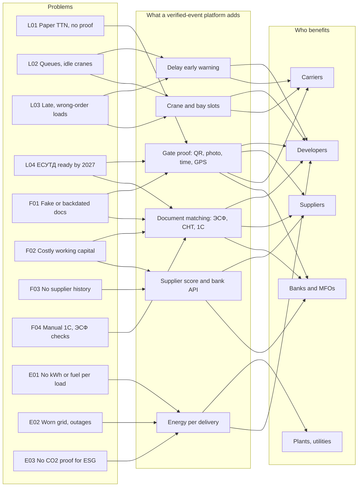

# KZ Supply-Chain Proof

Open research on the biggest problems in Kazakhstan's **logistics, fintech and energy** sectors, and a plan for using **independently verified physical events** (a delivery at a site gate, a weighed load, a pump's kWh) as proof for the money and documents that move against them.

*Version 0.1 · 31 October 2026 · living document. Built around the SitePulse project (`delivery-delay`), but the research is useful on its own.*

## The one-paragraph version

Kazakhstan is digitising the **document layer** fast: electronic invoices (ЭСФ) and consignment notes (СНТ) now cover building materials, E-Qurylys tracks state-funded sites, and banks finance suppliers against contracts and receivables. The sources we found do not show an independent record of **when a delivery physically arrived at a private site, in what quantity and condition, and whether a delay was the supplier's or the site's**. That physical layer is the gap this repo investigates. It is a hypothesis, and the repo says how to test it.

## The map

Problems on the left, what a verified-event platform can add in the middle, who benefits on the right. (An interactive version lives in the project chat; this one renders on GitHub.)

## What is in this repo

| File | What it answers |
|---|---|
| [docs/01-problem-solution-map.md](docs/01-problem-solution-map.md) | Every problem linked to a solution, a buyer and a first metric |
| [docs/02-logistics.md](docs/02-logistics.md) | Logistics problems: explanation, evidence, solution, hardware option |
| [docs/03-fintech.md](docs/03-fintech.md) | Fintech problems, same format |
| [docs/04-energy.md](docs/04-energy.md) | Energy problems, same format |
| [docs/05-delivery-vs-banks.md](docs/05-delivery-vs-banks.md) | What banks and state systems see, what they do not, and what to build |
| [docs/06-roadmap.md](docs/06-roadmap.md) | 90-day plan, 12-month phases, decision gates |
| [docs/07-visibility-plan.md](docs/07-visibility-plan.md) | How to become known to the companies this serves |
| [docs/08-sources.md](docs/08-sources.md) | Every source, with what it supports |
| [data/problems.csv](data/problems.csv) | The whole map as data (reuse it, chart it, correct it) |

## How to read confidence tags

- **[CONFIRMED]** a source we retrieved supports it (see `docs/08-sources.md`).
- **[LIKELY]** a reasonable inference or practitioner feedback that still needs testing.
- **[UNVERIFIED]** a claim we could not check. Do not repeat it as fact.

## Headline findings

1. **Documents are digitised, physical arrival is not (hypothesis).** ЭСФ/СНТ, E-Qurylys and bank factoring all work from documents and contracts.
2. **Transport documents are in flux.** Mandatory ЕСУТД registration of TTN and waybills was suspended until 1 June 2027.
3. **Money is expensive.** The National Bank base rate was cut to 15.75% on 23 October 2026, and average tenge corporate loans were above 22% in spring and summer 2026.
4. **Energy is a supply and data problem.** Wear is about 53% at power plants, 50% on heat networks and 66.2% on grids; the government targets an end to the electricity deficit by Q1 2027.
5. **The model is being funded abroad.** SubBase, Builtop, BRKZ and others raised money in 2026 for delivery, procurement and embedded finance in construction. None found is localised for Kazakhstan.

## Help us be right

Open an issue if you:

- **disagree** with a finding (say what you saw and where),
- **have data** on delivery delays, payment delays or energy use (anonymised is fine),
- **work at a bank, developer, supplier, carrier or utility** and can say what is missing in the tools you use today.

We will mark corrected claims in the changelog instead of silently deleting them.

## Disclaimer

This is research, not legal, tax or financial advice. Company names appear only as public information and imply no partnership or endorsement. Rules and rates change; check the original source before acting. Suggested licence for the text: CC BY 4.0 (add a `LICENSE` file before publishing).

---

## Кратко по-русски

**Что это.** Открытое исследование проблем логистики, финтеха и энергетики Казахстана и план, как использовать независимо подтверждённые физические события (приезд машины на объект, взвешенный груз, расход энергии насоса) как доказательство для документов и денег.

**Главная гипотеза.** Документы (ЭСФ, СНТ, договоры, E-Qurylys) уже оцифровываются, а банки финансируют по договорам и дебиторке. В найденных источниках нет независимой фиксации того, **когда и в каком количестве поставка реально прибыла на частный объект** и по чьей вине случилась задержка. Это гипотеза: в `docs/05-delivery-vs-banks.md` описано, как её проверить за 30 дней.

**Важно.** ЕСУТД (обязательная регистрация ТТН и путевых листов) приостановлена до 1 июня 2027 года. Базовая ставка Нацбанка — 15,75% (решение от 23 октября 2026 года).

**Как помочь.** Откройте issue: расскажите, чего не хватает в ваших инструментах, или поделитесь обезличенными данными по срокам поставок и оплат.
